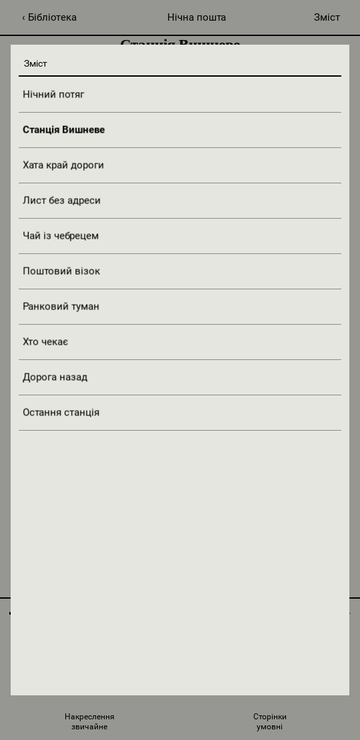
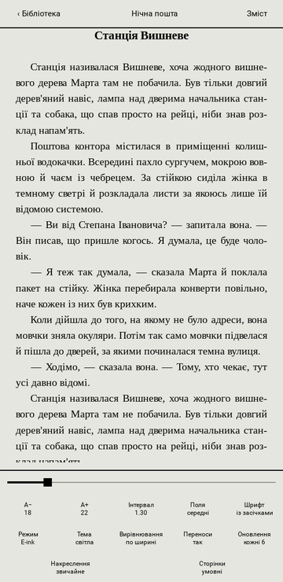
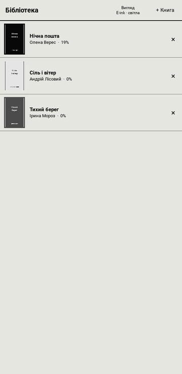

<div align="center">


# InkReader

**Читалка EPUB і FB2 з режимом «електронні чорнила».**
Без реклами, акаунта та інтернету. Linux, Windows і Android.

[Завантажити](https://github.com/DanyloSmashniuk/inkreader/releases/latest) · [Сайт](https://DanyloSmashniuk.github.io/inkreader/)

    

</div>

## Можливості

- **E-ink режим.** Чорний текст на кольорі паперу, без градієнтів і блиску. Підсилені сірі кольори, повне оновлення екрана кожні 1, 3, 6, 10 або 20 сторінок. Є й звичайний кольоровий режим, світла та темна теми.
- **Справжні сторінки.** Номери беруться зі сторінок паперового видання (page-list в EPUB). Якщо їх немає, рахуються умовні сторінки по 1800 знаків. Внизу завжди видно відсоток і повзунок прогресу.
- **Розділи з самого документа.** Зміст береться з навігації EPUB або з секцій FB2. Якщо його немає, читалка сама знаходить заголовки.
- **Охайний текст.** Вирівнювання по ширині, переноси слів (кирилиця за правилами складів, англійська через `pyphen`), без «вдів» і «сиріт». Вбудований шрифт Liberation Serif із жирним накресленням.
- **Чистка «кривих» файлів.** Зайві пробіли й невидимі символи, жорстко розбиті рядки, дублі заголовків, надто довгі абзаци.
- **Бібліотека** з обкладинками, позиція читання зберігається для кожної книги.
- **Керування.** Тап по краях гортає сторінки, тап по центру відкриває меню, свайп теж гортає. На комп'ютері також працюють клавіатура та колесо миші.

Формати: EPUB, FB2, FB2.ZIP.

## Встановлення

Готові збірки лежать у [Releases](https://github.com/DanyloSmashniuk/inkreader/releases/latest).

**Android** (7.0+, arm64): завантажте `InkReader.apk`, відкрийте файл і дозвольте встановлення з цього джерела.

**Linux** (x86_64):

```bash
tar -xf InkReader-linux.tar.xz
cd InkReader-linux && ./install.sh
```

Скрипт поставить програму в `~/.local/share/InkReader` і додасть ярлик у меню. Також можна просто запустити `InkReader/InkReader` без встановлення. Книги відкриваються й через «Відкрити за допомогою» у файловому менеджері.

**Windows** (10/11, x64): завантажте `InkReader-setup.exe` і запустіть його: програма встановиться в профіль користувача (адміністратор не потрібен), з ярликом у меню «Пуск» та, за бажанням, відкриттям `.epub` і `.fb2`. Windows може застерегти про невідомого видавця, бо програма не підписана: натисніть «Докладніше» → «Все одно виконати».

## Клавіші (комп'ютер)

| Дія | Клавіші |
| --- | --- |
| Наступна сторінка | `Space`, `Enter`, `PgDn`, `→`, `↓` |
| Попередня сторінка | `Backspace`, `PgUp`, `←`, `↑` |
| Початок / кінець книги | `Home` / `End` |
| Зміст | `T` або `C` |
| Меню | `M` |
| Повний екран | `F11` |
| Назад до бібліотеки | `Esc` |

## Запуск із вихідного коду

```bash
python3 -m venv .venv && . .venv/bin/activate
pip install -r requirements.txt
./scripts/run.sh                 # або ./scripts/run.sh книга.epub
```

Дані (книги, обкладинки, стан) зберігаються в `~/.config/inkreader/` на Linux і в `%APPDATA%\inkreader\` на Windows.

## Збірка

**Linux** (PyInstaller):

```bash
./scripts/build_linux.sh         # dist/InkReader/InkReader
./scripts/package_linux.sh       # dist/InkReader-linux.tar.xz
```

**Windows** (PyInstaller) збирається автоматично на GitHub Actions (`.github/workflows/windows.yml`) і потрапляє в реліз як інсталятор `InkReader-setup.exe` (Inno Setup, `scripts/installer.iss`). Локально на Windows те саме робить `scripts\build_windows.ps1` (для інсталятора потрібен Inno Setup 6).

**Android** (buildozer, потрібні Linux, JDK 17 і Python 3.11 у venv). Збірка націлена на API 36 і NDK 28c, тобто відповідає вимогам Google Play (target API 36, вирівнювання 16 КБ):

```bash
python3.11 -m venv ~/build311
./scripts/build_android.sh       # ~/inkreader-apk/bin/*.apk
```

Скрипт збирає в окремій теці, застосовує невеликий патч до python-for-android (обхід помилки встановлення android-коліс) і перевіряє вирівнювання бібліотек. Шлях до робочої теки має містити лише латиницю: інакше Java може не знайти файли. Налаштування лежать у [`buildozer.spec`](buildozer.spec).

## Структура

```
src/
  main.py          інтерфейс (Kivy): бібліотека, читання, меню, клавіші
  book_loader.py   розбір EPUB і FB2: текст, розділи, сторінки, обкладинки
  textfix.py       чистка тексту й нормалізація блоків
  hyph.py          переноси слів
  typeset.py       верстка: рядки, вирівнювання, розбиття на сторінки
  fontdata.py      вбудований шрифт Liberation Serif (SIL OFL 1.1)
docs/              сайт (GitHub Pages)
scripts/           запуск, збірка й пакування
tests/             тести розбору книг і тексту
assets/            іконки та знімки екрана
```

Книга після розбору це список блоків `(тип, текст)`, де тип: `h` заголовок, `p` абзац, `v` вірш, `s` розділювач, `i` картинка. Верстка перетворює їх на сторінки, а `main.py` лише малює готові рядки.

## Тести

```bash
pip install -r requirements-dev.txt
pytest
```

## Сайт

Папка `docs/` публікується через GitHub Pages (Settings → Pages → Deploy from a branch → `main` → `/docs`). Кнопка «Завантажити» на сайті сама визначає систему й бере файл з останнього релізу, тож у релізі файли мають називатись `InkReader.apk` і `InkReader-linux.tar.xz`. Свій логін вказується в рядку `REPO` у `docs/index.html`.

## Ліцензія

Код поширюється за ліцензією [MIT](LICENSE). Вбудований шрифт Liberation Serif поширюється за ліцензією SIL OFL 1.1.
